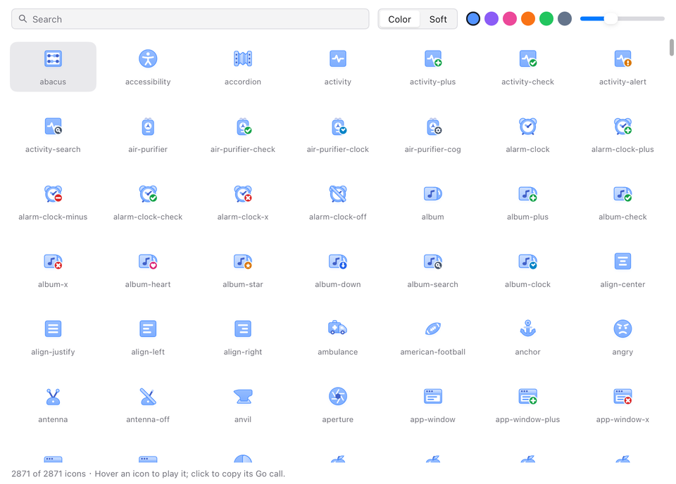

# Kubai Icons for MyGo

[](https://github.com/yldm-tech/mygo-kubai-icons/actions/workflows/ci.yml)
[](https://pkg.go.dev/github.com/yldm-tech/mygo-kubai-icons)

English · [简体中文](README.zh-CN.md)

The 2,871 icons of [Kubai Icons](https://github.com/kubai087/kubai-icons) for [MyGo](https://github.com/egoist/mygo) native UI, moving on hover as they do on the web: a folder opens, an envelope unseals, a calendar turns to the next day. MyGo draws them itself, with no web view.


This is an unofficial port. Kubai Icons is designed by Kubai087; the icons are MIT licensed, and the Kubai name is theirs.

## Install

```sh
go get github.com/yldm-tech/mygo-kubai-icons
```

Requires MyGo v0.8.3 or later.

## Use

Each icon is a function returning a shared `*kubai.Icon`. `View` shows it and plays its motion while the pointer is over it:

```go
import (
	"github.com/egoist/mygo/ui"
	kubai "github.com/yldm-tech/mygo-kubai-icons"
)

func sidebar(c *ui.Context) {
	ui.Row(c).Gap(8).Children(func() {
		kubai.Folder().View(c, kubai.Options{Size: 24})
		ui.Text(c, "Documents")
	})
}
```

Names follow upstream's ids in MixedCaps: `folder-plus` is `FolderPlus`, `wifi-off` is `WifiOff`. Every base icon is followed by its badged composites (`FolderCheck`, `BellX`) and, where upstream has one, a slashed `-off` version.

### Options

| Field | Effect |
|---|---|
| `Size` | Side of the icon's canvas in DIPs, 24 by default. The shadow reaches a little past it. |
| `Color` | The accent every colour of the icon derives from, `kubai.DefaultColor` (#5393FF) by default. |
| `Variant` | `kubai.Color`, or `kubai.Soft` for the clear look. |
| `BadgeColor`, `SemanticBadge` | Ink of a corner badge's disc, or each badge's own colour: green for add, red for remove. |
| `Hovered` | Plays the motion as if hovered, so a parent can drive it: `Options{Hovered: row.Hovered()}`. |
| `Still` | Ignores the pointer. |
| `Active` | The toggled state of an icon a click toggles (`Icon.Tap()`), such as a saved bookmark. |
| `NoShadow` | Leaves out the drop shadow. |
| `Label` | Names the icon for assistive technology; without one it is a decoration. |

Motion follows MyGo's reduced-motion preference.

For places that take an SVG rather than an element, such as a menu or tray icon, `Icon.SVG(options, hovered)` returns a `*ui.SVG` of the rest pose or the end of the hover, without the shadow.

### Binary size

Unused icons are left out of the executable. A base icon and its composites share one compressed blob, 1.2 KB at the median and under 16 KB at most, decoded the first time one of them is shown. Package `all` lists every icon by name for galleries and pickers; importing it keeps all of them, which made a test program 3.3 MB larger.

## Gallery

```sh
go run github.com/yldm-tech/mygo-kubai-icons/examples/gallery@latest
```

Search, pick an accent, the soft look and a size, hover to play, click to copy the Go call.



## How it works

Upstream icons are JavaScript: each declares its layers, a rest and a hover target, and a `draw()` that recomputes its geometry from numbers interpolated between the two. Rather than translate 900 `draw()` functions, `gen/generate.mjs` runs upstream's own renderer at keyframes along each motion and stores the markup as a template with numeric slots. Keyframes are placed adaptively: an interval is split until interpolating its numbers in a straight line stays within 0.04 canvas units (about 0.06 px at 48 px) of what `draw()` gives, so a simple slide needs five keyframes and a damped shake about forty. Swings and pulses, which upstream plays only on the way in, get a separate track for the way back.

At run time, `View` animates progress with MyGo's `AnimateTo` along upstream's curve (460 ms, `cubic-bezier(.22, 1, .36, 1)`), interpolates the slots, resolves the colours with a port of upstream's colour derivation and draws the markup with MyGo's SVG renderer. A frame the cache does not hold takes about 0.08 ms to build and parse.

## Differences from upstream

MyGo's SVG renderer draws no filters and no text, so:

- The drop shadow is a second layer, the silhouette of the shadowed parts blurred with MyGo's `Blur`, at upstream's offset and opacity. It is close, not identical.
- The faint inner highlight along the top edge of bodies is left out.
- The text in seven icons (`calendar`, `circle-help`, `languages`, `list-ordered`, `parking`, `quiz`, `spell-check` and their composites) is drawn as glyph outlines from Go Bold, which differs a little from the system font upstream uses; the one CJK glyph, 文, is drawn by hand in strokes of the same weight.
- Keyboard focus does not play the motion by itself; pass `Hovered` from the focused control.

To compare the two, `internal/compare/compare.sh` renders icons with upstream's code through `rsvg-convert` and with this port through MyGo, side by side.

## Regenerate

```sh
git clone https://github.com/kubai087/kubai-icons ../kubai-icons
git -C ../kubai-icons checkout kubai-icons@0.2.2   # or a newer release
node gen/generate.mjs --upstream ../kubai-icons
go test ./...
```

Update `gen/upstream.json` to the release generated from; CI checks the generated files against it with `--check`. `go run ./gen/glyphs > gen/glyphs.json` rebuilds the glyph table.

## License

MIT for this module's code. The icons are from Kubai Icons, MIT licensed by Kubai087 and the Kubai Icons contributors ([licenses/kubai-icons.txt](licenses/kubai-icons.txt)). The glyph outlines come from the Go fonts by Bigelow & Holmes ([licenses/go-fonts.txt](licenses/go-fonts.txt)).
