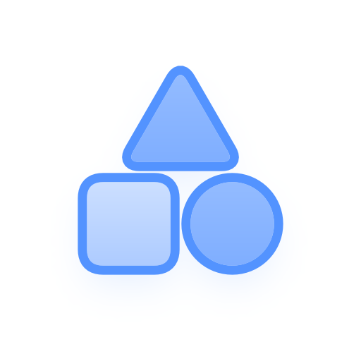
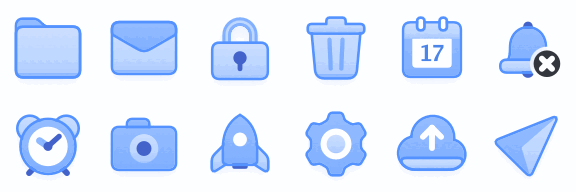
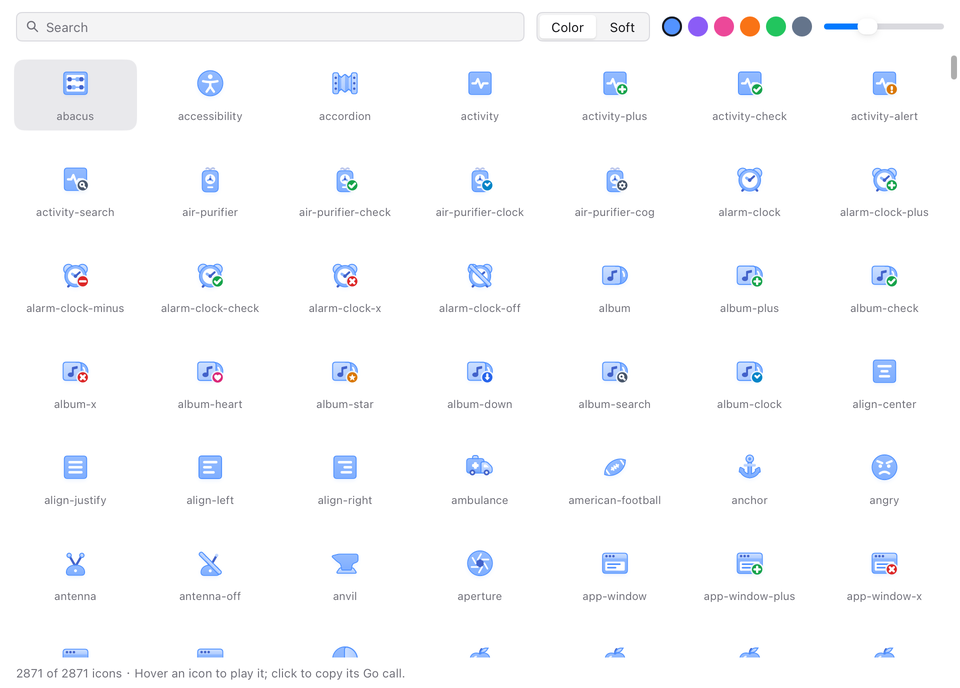

<p align="center"></p>

# Kubai Icons for MyGo

[](https://github.com/yldm-tech/mygo-kubai-icons/actions/workflows/ci.yml)
[](https://pkg.go.dev/github.com/yldm-tech/mygo-kubai-icons/kubai)

[English](README.md) · 简体中文

把 [Kubai Icons](https://github.com/kubai087/kubai-icons) 的 2,871 个图标搬到 [MyGo](https://github.com/egoist/mygo) 原生 UI，悬停时和网页版一样动起来：文件夹打开，信封拆开，日历翻到第二天。全部由 MyGo 自己绘制，不用 WebView。



这是非官方移植。Kubai Icons 由 Kubai087 设计，图标以 MIT 协议发布，Kubai 这个名字归原作者所有。

## 安装

```sh
go get github.com/yldm-tech/mygo-kubai-icons
```

需要 MyGo v0.8.3 或更高版本。

## 用法

每个图标是一个函数，返回共享的 `*kubai.Icon`。`View` 把它显示出来，指针悬停时播放动画：

```go
import (
	"github.com/egoist/mygo/ui"
	"github.com/yldm-tech/mygo-kubai-icons/kubai"
)

func sidebar(c *ui.Context) {
	ui.Row(c).Gap(8).Children(func() {
		kubai.Folder().View(c, kubai.Options{Size: 24})
		ui.Text(c, "Documents")
	})
}
```

函数名是上游 id 的驼峰写法：`folder-plus` 是 `FolderPlus`，`wifi-off` 是 `WifiOff`。每个基础图标后面跟着它带角标的组合版（`FolderCheck`、`BellX`），上游有的还带一个加斜杠的 `-off` 版。

### Options

| 字段 | 作用 |
|---|---|
| `Size` | 图标画布的边长，单位 DIP，默认 24。阴影会略超出这个范围。 |
| `Color` | 主色，图标的所有颜色都由它推导，默认 `kubai.DefaultColor`（#5393FF）。 |
| `Variant` | `kubai.Color`，或清透风格 `kubai.Soft`。 |
| `BadgeColor`、`SemanticBadge` | 角标圆盘的颜色，或使用各角标自带的语义色：加是绿色，删是红色。 |
| `Hovered` | 按悬停状态播放动画，让父元素来驱动：`Options{Hovered: row.Hovered()}`。 |
| `Still` | 不响应指针。 |
| `Active` | 点击切换类图标（`Icon.Tap()`，比如书签）的已选中状态。 |
| `NoShadow` | 不画投影。 |
| `Label` | 给辅助技术的名称；不设置时视为装饰元素。 |

动画遵循 MyGo 的「减少动态效果」设置。

菜单图标、托盘图标这类只接受 SVG、不接受元素的地方，用 `Icon.SVG(options, hovered)` 取静止状态或悬停结束状态的 `*ui.SVG`（不含投影）。

### 二进制体积

没用到的图标不会进入可执行文件。一个基础图标和它的组合版共用一块压缩数据，中位数 1.2 KB，最大不到 16 KB，第一次显示其中任意一个时才解码。`all` 包按名称列出全部图标，适合图库和选择器；导入它会保留所有图标，实测让测试程序增大了 3.3 MB。

## 图库

[在浏览器里试用](https://kubai.yldm.ai/)：图库示例编译成 WebAssembly，由 MyGo 绘制，和桌面版一样，下载约 5.5 MB。也可以在本机运行原生版：

```sh
go run github.com/yldm-tech/mygo-kubai-icons/examples/gallery@latest
```

可以搜索，选主色、清透风格和尺寸，悬停播放，点击复制 Go 调用代码。界面跟随系统或浏览器语言显示中文或英文，也能用中文名搜索图标（`all.Entry.Zh`）。



## 实现原理

上游图标是 JavaScript：每个图标声明自己的图层、静止和悬停两组目标参数，以及一个 `draw()`，根据两组参数之间插值出的数字重新计算几何形状。这里没有把 900 个 `draw()` 逐个翻译成 Go，而是由 `gen/generate.mjs` 沿着每段动画在关键帧处调用上游自己的渲染器，把生成的标记存成带数字槽位的模板。关键帧自适应放置：一个区间会不断二分，直到对其中的数字做线性插值与 `draw()` 实际结果的误差不超过 0.04 个画布单位（48 px 下约 0.06 px）。所以简单的平移只要 5 个关键帧，带阻尼的摇晃大约 40 个。摆动、脉冲这类上游只在进入时播放的动画，返回时另有一条轨道。

运行时，`View` 用 MyGo 的 `AnimateTo` 按上游的曲线（460 ms，`cubic-bezier(.22, 1, .36, 1)`）推进进度，对槽位插值，用移植过来的上游配色推导算出颜色，再交给 MyGo 的 SVG 渲染器绘制。缓存未命中的一帧，生成加解析约 0.08 ms。

## 与上游的差异

MyGo 的 SVG 渲染器不画滤镜，也不画文字，因此：

- 投影是单独的一层：把带阴影部分的剪影用 MyGo 的 `Blur` 模糊，偏移和不透明度与上游一致。效果接近，但不完全相同。
- 图形顶边那道很淡的内高光省略了。
- 七个图标（`calendar`、`circle-help`、`languages`、`list-ordered`、`parking`、`quiz`、`spell-check` 及其组合版）里的文字，转换成了 Go Bold 字体的字形轮廓，和上游使用的系统字体略有不同；唯一的中文字「文」是按相同笔画粗细手绘的。
- 键盘焦点不会自动触发动画；需要从获得焦点的控件传入 `Hovered`。

想对比两者，可以运行 `internal/compare/compare.sh`：它用上游代码经 `rsvg-convert` 渲染图标，再用本移植经 MyGo 渲染，左右并排输出。

## 目录结构

| 路径 | 内容 |
|---|---|
| `kubai/` | 用户导入的包：运行时（`kubai.go`、`data.go`、`color.go`）和生成的图标（`icons_gen.go`）。 |
| `all/` | 按名称列出全部图标，供图库和选择器使用。 |
| `examples/gallery/` | 原生图库示例。 |
| `site/` | 在 GitHub Pages 上以 WebAssembly 加载图库的页面；由 `.github/workflows/pages.yml` 构建并发布。 |
| `gen/` | 生成器、字形表和锁定的上游版本。 |
| `internal/compare/` | 把本移植和上游并排渲染对比的脚本，以及生成动画 GIF 的脚本。 |
| `internal/brand/` | 用本包绘制 logo 和社交预览图：`go run ./internal/brand`。 |
| `licenses/` | 图标和 Go 字体的许可证。 |

## 重新生成

```sh
git clone https://github.com/kubai087/kubai-icons ../kubai-icons
git -C ../kubai-icons checkout kubai-icons@0.2.2   # 或更新的版本
node gen/generate.mjs --upstream ../kubai-icons
go test ./...
```

把 `gen/upstream.json` 改成生成时所用的版本；CI 会用 `--check` 校验生成文件与它一致。`go run ./gen/glyphs > gen/glyphs.json` 重建字形表。

## 许可

本模块代码采用 MIT 协议。图标来自 Kubai Icons，由 Kubai087 及 Kubai Icons 贡献者以 MIT 协议发布（[licenses/kubai-icons.txt](licenses/kubai-icons.txt)）。字形轮廓来自 Bigelow & Holmes 设计的 Go 字体（[licenses/go-fonts.txt](licenses/go-fonts.txt)）。
